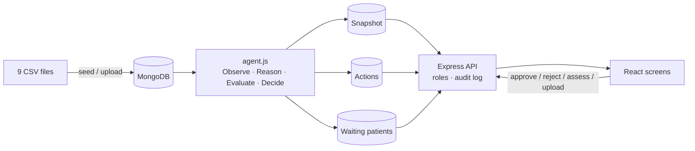

# Sanjeevani Operations Agent

**Blocked beds, not busy wards.** An operations agent for **CYPHER 2026 · Challenge 05 – The Blocked Bed**. It works out why patients at Sanjeevani Multispeciality Hospital are stuck, ranks the problems, proposes fixes for the right person to approve, and explains every step with evidence from the hospital data.


> **Decision support only.** The data is synthetic. Every action is approved by authorised staff. The agent never diagnoses, prescribes, moves patients, reassigns staff or releases beds by itself.

---

## Contents
- [The problem](#the-problem)
- [What the agent does](#what-the-agent-does)
- [What it finds in the dataset](#what-it-finds-in-the-dataset)
- [Screens and roles](#screens-and-roles)
- [Getting started](#getting-started)
- [The hour-14 data update](#the-hour-14-data-update)
- [How it works](#how-it-works)
- [API](#api)
- [Tests](#tests)
- [Deployment](#deployment)
- [Project structure](#project-structure)
- [Safety and limits](#safety-and-limits)

---

## The problem

Emergency patients at Sanjeevani are waiting **90 minutes today against a usual 35**. Everyone's first answer is "the emergency department is overloaded".

Dr. Suresh Iyer, the Medical Superintendent, needs to know:
- Which departments need attention today?
- Why is the emergency wait so long?
- Are beds blocked by late discharges or test reports?
- Are some doctors overloaded while others are free?
- Which problems are most urgent, and what should the team do first?

The clues sit in nine separate files: admissions, appointments, beds, diagnostics, discharges, emergency waiting times, feedback, patients and staff. Each one on its own only says "busy". The agent joins them up to find the real cause.

## What the agent does

Every step of the agent loop is a working screen, and every figure is computed from the data. Nothing is typed into the code.

| Step | What the agent does | Where you see it |
|---|---|---|
| **Observe** | Reads the 9 CSV files from MongoDB: beds, discharges, tests, waits, rosters, appointments, complaints | Overview figures |
| **Reason** | Links signals into a cause chain and marks the root cause | Issues → cause chain |
| **Evaluate** | Compares options with their expected effect and scores each issue as urgency × impact (1–5 each) | Issues → options |
| **Decide** | Ranks issues; the top three become "What needs my attention today?" | Overview |
| **Act** | Proposes an action with a named owner; approval creates a task (T-101 …) | Action queue |
| **Explain** | Shows evidence lines that cite the source file and record IDs, and logs every decision | Evidence, audit log |

## What it finds in the dataset

Snapshot **2026-11-16 10:00** (one hour after the latest emergency waiting-time reading):

| # | Issue | Evidence |
|---|---|---|
| 1 | **Emergency backed up by blocked beds, not patient volume** | ED wait 90 vs 35 min; 7/7 ED beds full; 9 patients waiting with no bed; ED-06 and ED-07 held by discharges waiting on late CT reports and unsigned summaries; 10 beds free in General Wards A/B and the Ortho Ward |
| 2 | **ICU full: 2 critical patients waiting** | ICU 12/12; P1087 (P1) waiting since 07:00, P1088 (P2) since 08:30; no ICU discharge pending |
| 3 | **6 discharges stuck on pending tasks** | 4 General Ward discharges waiting 28 h on MRI reports. The 3 Paediatric discharges are leaving within the hour, so they are *not* flagged |
| 4 | **11 test reports overdue, 6 holding a discharge** | MRI T0003–T0006 12 h late; CT T0001/T0002 3 h late |
| 5 | **Dr. Prakash Rao overloaded while Dr. Anita Menon has open slots** | 38 patients today (usually 17), 95 min average wait; 9 open slots from 11:00 to 15:00 |
| 6 | **Emergency evening shift short-staffed** | 1 of 2 doctors (one on leave), 3 of 5 nurses |
| 7 | **Complaints that trace to operations** | Waiting-time and discharge-delay complaints linked to the issues above |
| 8 | **Orthopaedics 10:00–11:00 runs late every day** | 90 min average wait vs 24 in other hours; matches repeated complaints |

> Scores are demonstration settings, not validated hospital standards. When the data does not show a cause (for example *why* reports are late), the agent says so instead of guessing.

## Screens and roles

| Screen | What it shows |
|---|---|
| **Overview** | Headline, key figures, goals, today's top three, ranked-issue carousel, department pressure tiles |
| **Patient Triage** | Waiting patients from the data (ICU P1/P2 ranked; ED patients with no recorded priority wait for a clinician to assess them), plus new registrations with a live assessment as you type |
| **Issues** | Cause chain, options considered, chosen action and status, evidence |
| **Actions** | Approve / reject (a written reason is required) / mark done; audit log |
| **Beds & Discharges** | Bed grid per ward, discharge requests and what each is waiting on |
| **Diagnostics & Staff** | Overdue tests, doctor workload, clinics and slots, shift cover |
| **Complaints** | All feedback, linked to operational issues where the data supports it |
| **Data** | The 9 files, uploads of updated files, the snapshot time, restoring the original data |

Sign in with your full name, a work email, a staff ID (such as `SMH-10234`) and a role. Each role sees only its own screens and approves only its own kind of action. The server checks this on every request.

| Role | Screens | Can approve |
|---|---|---|
| Medical Superintendent | All, including Data | Everything |
| Shift Manager | All, including Data | Staff, scheduling, workload, beds, triage |
| Doctor | Overview, Triage, Beds, Diagnostics | Beds, triage |
| Nurse | Triage, Beds | None; can register and assess patients |
| Nursing Head | Overview, Triage, Issues, Actions, Beds, Diagnostics | Staff, beds, triage |
| Lab Supervisor | Overview, Issues, Actions, Diagnostics | Lab escalations |
| Department Head | Overview, Triage, Issues, Actions, Beds, Diagnostics | Workload, scheduling, staff, triage |
| Discharge Coordinator | Overview, Issues, Actions, Beds | Discharge tasks |
| Front Office / Reception | Triage, Actions, Complaints | Scheduling, complaints |

## Getting started

### Prerequisites
- [Node.js 20+](https://nodejs.org)
- [MongoDB 7](https://www.mongodb.com/try/download/community) running locally, **or** a free [MongoDB Atlas](https://www.mongodb.com/atlas) cluster
- *(Optional)* [Docker Desktop](https://www.docker.com/products/docker-desktop/)

### Option A: Docker (one command)
```bash
docker compose up --build
```
Open **http://localhost:4000**. MongoDB, the API and the built website all start together, and the dataset loads on first start.

### Option B: run locally (VS Code)
```bash
# 1. API
cd server
cp .env.example .env        # Windows: copy .env.example .env
npm install
npm run seed                # loads the 9 CSV files into MongoDB and runs the agent
npm run dev                 # http://localhost:4000

# 2. Website (second terminal)
cd client
npm install
npm run dev                 # http://localhost:5173
```

### Environment variables (`server/.env`)
| Name | Example | Purpose |
|---|---|---|
| `MONGO_URI` | `mongodb://127.0.0.1:27017/sanjeevani` | MongoDB connection string (Atlas works too) |
| `PORT` | `4000` | API port |
| `AUTH_SECRET` | *long random string* | Signs sign-in sessions. Generate one with `node -e "console.log(require('crypto').randomBytes(32).toString('hex'))"` |
| `CORS_ORIGIN` | `https://your-site.com` | Optional; only needed if the website is hosted on a different domain |

Never commit `.env`. It is already in `.gitignore`.

## The hour-14 data update

At hour 14 an updated version of one dataset file is released (same columns, same format). To load it:

1. Sign in as **Medical Superintendent** or **Shift Manager** and open **Data**.
2. Click **Upload update** on the row of the file that changed and choose the new CSV.
   - The file is checked first. If its columns differ, nothing changes and the reason is shown.
3. Set **Snapshot time** to `2026-11-16 14:00` and click **Save time**.
4. The page lists exactly what changed: new, changed and cleared issues, and the key figures.
   - Proposals the new data no longer supports are withdrawn.
   - Decisions already made (approved, done, rejected) are kept.
   - **Restore original dataset** puts the original files back.

## How it works



- **`dataset.js`**: the nine files, a CSV reader (quotes, commas, line breaks), and column checks for uploads.
- **`agent.js`**: pure functions with no database access.
  - `observe()` builds wards, discharges, overdue tests, waits, doctors, rosters and late clinic hours.
  - `reason()` runs one rule per kind of problem. A rule reports an issue only when the data supports it.
  - `run()` ranks the issues and prepares everything the screens show.
- **`store.js`**: loads files from MongoDB, runs the agent, saves the snapshot, keeps proposed actions and data-sourced patients in step with the data, and reports what changed.
- **Patient triage**: `design-triage.js` holds the original danger-sign rules. `triage.js` is a wider engine used as a safety net. It understands everyday wording, typos, negation, NEWS2 and children's age bands, and it can only raise a category, never lower it. Every category is confirmed or changed by a nurse or doctor.

## API

All responses are `{ ok: true, data }` or `{ ok: false, error: { message, field } }`. Everything except health, roles and sign-in needs `Authorization: Bearer <token>`.

| Method | Path | Purpose |
|---|---|---|
| GET | `/api/health` | Health check (used by Docker and Render) |
| POST | `/api/auth/signin` | Sign in with `{ name, email, staffId, role }` |
| GET | `/api/overview` | Headline, figures, ranked issues, departments |
| GET | `/api/issues` | Issues with cause chain, options, actions, evidence |
| GET · PATCH | `/api/actions` · `/api/actions/:code` | Action queue and audit log · approve / reject / done |
| GET · POST · PATCH | `/api/patients` · `/api/patients/:id` | Queue · register · confirm or change (with reason) |
| POST | `/api/triage/preview` | Live assessment while typing |
| GET | `/api/beds`, `/api/diagnostics-staff`, `/api/complaints` | Screen data |
| GET | `/api/data` | Dataset files and snapshot time |
| PUT | `/api/data/files/:name` | Replace a file (body is the CSV text, `Content-Type: text/csv`) |
| PUT | `/api/data/snapshot-time` | `{ "value": "2026-11-16 14:00" }`, or empty for automatic |
| POST | `/api/data/reset` · `/api/demo/reset` | Restore original files · full demo reset |

## Tests

```bash
cd server
npm test                                          # 32 unit tests: agent on the dataset, update scenarios, triage rules
BASE_URL=http://localhost:4000 npm run test:api   # 38 end-to-end API checks (server must be running)
```

The unit tests cover:
- the planted problems and the ranking
- an "hour-14" update where the MRI reports arrive
- an update that clears the emergency department
- a doctor going on leave
- the CSV reader and column checks

GitHub Actions (`.github/workflows/ci.yml`) runs both suites against a real MongoDB 7 on every push. It also builds the website and the Docker image.

## Deployment

1. Create a free **MongoDB Atlas** cluster and copy its connection string.
2. On **Render**, choose **New → Blueprint**, pick this repository, and paste the connection string as `MONGO_URI`.
3. `render.yaml` builds the Dockerfile, generates `AUTH_SECRET`, checks `/api/health` and redeploys on every push to `main`.

## Project structure

```
sanjeevani-ops/
├── server/
│   ├── agent.js           # Observe → Reason → Evaluate → Decide → Act → Explain
│   ├── dataset.js         # the 9 files, CSV reader, column checks
│   ├── store.js           # MongoDB, agent re-runs, actions and patients kept in step
│   ├── index.js           # Express API, role checks, audit log
│   ├── auth.js            # sign-in and signed sessions
│   ├── config.js          # roles, screens, approval rights
│   ├── assess.js · design-triage.js · triage.js   # patient triage
│   ├── models.js · seed.js
│   ├── data/original/     # the hospital dataset (CSV) + DATASET.md
│   └── test/              # agent, triage and API tests
├── client/
│   └── src/
│       ├── pages/         # Overview, Triage, Issues, Actions, Beds, Diag, Complaints, Data, Login
│       ├── ui.jsx · api.js · App.jsx
│       └── styles.css
├── Dockerfile · docker-compose.yml · render.yaml
└── .github/workflows/ci.yml
```

## Safety and limits

- **Fictional data only:** no real patient information.
- **Decision support, not diagnosis:** no prescriptions or treatment advice.
- **Nothing happens automatically:** no patient transfers, staff moves or bed releases. Staff confirm a bed is ready before it is reallocated.
- **Every action needs approval from an authorised role,** and every decision is written to the audit log.
- **Transparent rules:** the agent uses rules you can read in `agent.js`. It does not claim a language model makes these decisions.

---

**Team:** [Team name] · [Member names] · CYPHER 2026
